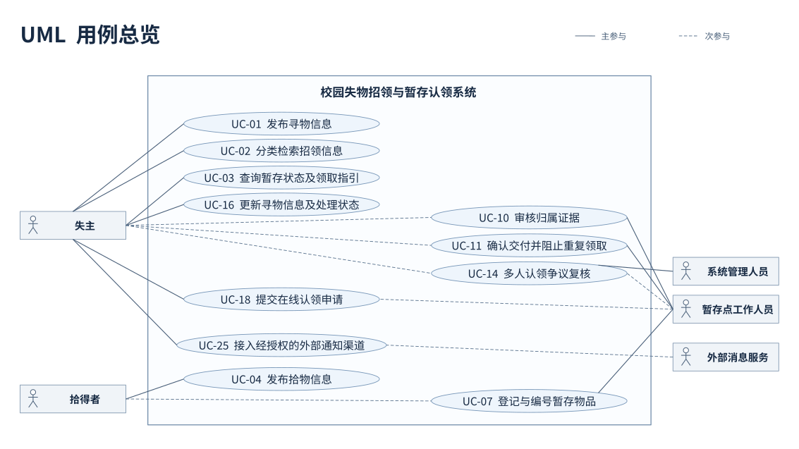

# 校园失物招领与暂存认领系统用例图

实线表示主参与关系，虚线表示次参与关系。同一角色可在不同用例中承担不同职责。例如，失主是在线提交认领申请的主参与者，在审核归属证据和确认交付中是次参与者。

用例名称、编号及业务流程见 [用例场景 PR #14](https://github.com/wwwchangjin/campus-lost-found-system/pull/14/files)。

[下载可编辑的 PowerPoint 图源](use-case-diagram.pptx)。修改后可从 Impress 导出单页 PDF，再用 `pdftocairo -svg` 生成 GitHub 预览。
